# Class D Lifecycle — The Diagram Set

**Audience:** Developers building Class D miniapps on the framework.
**Companion documents:** *The Invocation Lifecycle Contract — A Developer's Guide* (prose reference, `lifecycle-contract-writeup.md`) and *Writing Class D Miniapps: Complexity, Failure Modes, and Framework Mitigations* (the "why"). This document is the visual edition: the twelve diagrams that carry the cognitive load, each with a short writeup of what to internalize.
**Grounding:** The normative contract (Prompt 15.2 P1) and its transition tables (§7), lock discipline (§4), sweeper design (§8), and the adversarial-review findings (X-01–X-05). Section references like (§7/M3) point into the contract.
**Status note:** These diagrams describe the accepted target contract, not a claim that every capability is already shipped — P2 implementation is in progress.

Rendered previews of every diagram are in [`diagram-previews/`](/home/z/my-project/download/diagram-previews/) if you prefer PNG over live mermaid.

## Diagram index — what each one teaches

| # | Diagram | Concept | You should be able to… |
|---|---|---|---|
| 1 | Concept map | The whole territory | Name the six machines, six rules, five identities, and the ownership split |
| 2 | Invocation lifecycle | M1 | Trace an invocation from claim to a terminal state, including quarantine |
| 3 | Effect ledger | M3 | Explain every effect state and why `ATTEMPTING` is the point of no return |
| 4 | Cancel race | X-05 | Predict who wins when cancel and authorize interleave |
| 5 | Submission choke point | Rule 3 | Explain why a retry cannot bypass approval |
| 6 | Retry as re-entry | Rule 4 | Dispatch any retry on persisted state, never on a flag |
| 7 | Approval bridge + sweeper | X-11/X-12 | Know what recovers automatically and under which conditions |
| 8 | Authorize transaction | Lock order | Enumerate what the one pre-send transaction revalidates, in order |
| 9 | Five identities | §6 | Pick the right key for each operation and know the conflation bug it prevents |
| 10 | Attach + DETACH-ONLY | X-08 | Predict what cancel does to owners, observers, and attached rows |
| 11 | Ownership boundary | Part 4 | Know exactly which work is yours |
| 12 | Testing discipline | §9/§13 | Design fixtures that actually discriminate |

---

## 1. The concept map — the territory on one screen

A Class D miniapp is a durable business workflow: multi-day, multi-stage, with waits, approvals, external effects, and a requirement that progress survive process death. The framework's entire design is six durable state machines, six rules every transition obeys, five identity scopes that must never be conflated, and a recovery layer that converges the system without polling. This map is the mnemonic; every other diagram zooms into one branch.

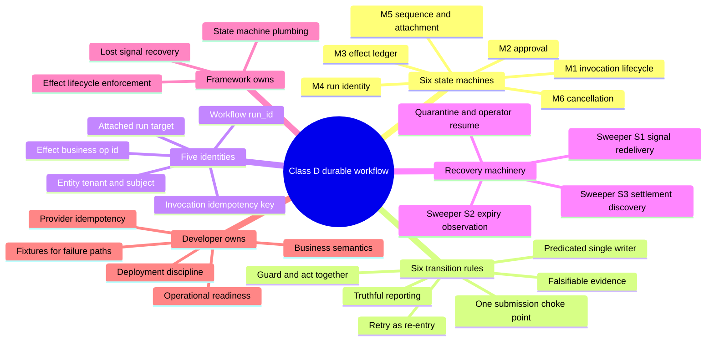

**Internalize:**

- The machines are *durable* — their state lives in PostgreSQL, not in process memory. "The process restarted" is never an excuse for lost state; it is a case the machines are built to converge from.
- The six rules are not style preferences; they are how each of the five HIGH bugs (X-01–X-05) was made structurally impossible.
- Everything in "Framework owns" is inherited for free by using the primitives. Everything in "Developer owns" is real work with named acceptance criteria.

---

## 2. The invocation lifecycle (M1) — where your invocation lives

This is the state machine you actually observe from miniapp code: submit, wait for approval, run, wait for events, settle — or dead-letter into quarantine where only an operator can move it forward. Two things deserve attention: the park is **one atomic transaction** (so a crash between "claimed" and "parked" can never strand a record — the failure that was X-01/X-02), and settlement is a single predicated operation shared by the poll path and the sweeper (so `run-settled` is audited exactly once whether or not anyone polls).

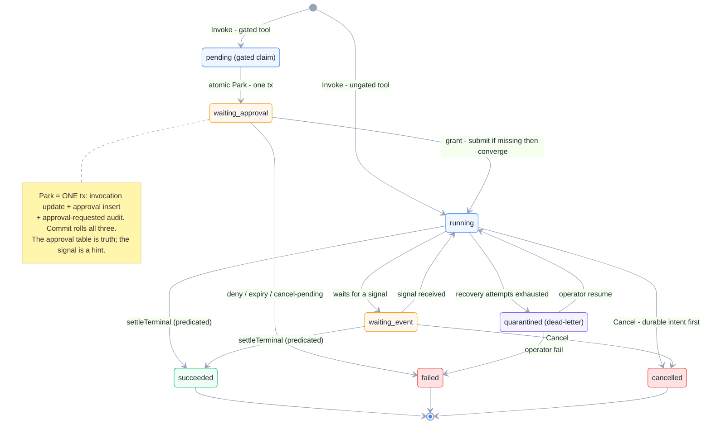

**Internalize:**

- **Gated tools start as `pending`, not `running`** — the authorization decision happens before dispatch. `running` means either ungated, or granted and converged.
- **Quarantine is nonterminal.** A dead-lettered workflow is *not* failed: it waits for an operator to resume (SDK resume first, then the predicated invocation update) or settle it as failed with attribution. Resume-after-cancel is refused; concurrent resume-vs-fail serialize on the predicate.
- **Terminals are terminal.** A settled invocation never returns to a live state. Cancel on an already-cancelled record redelivers the stop — it never re-lives the invocation.
- **Attached invocations settle through the owner.** If your record carries `attached_run_id`, its terminal outcome is the target's outcome, truthfully propagated — never `succeeded` while the target is still active.

Source: contract §7/M1, §7/M4 quarantine rows, §8/S3.

---

## 3. The effect ledger (M3) — the honest answer to "did the provider do it?"

This is the heart of the contract. Every external side effect is recorded as an intent *before* any provider call, advances to `ATTEMPTING` only through a fully revalidating authorization transaction, and settles from evidence. The two states that matter most are `PENDING` (a provisional reservation — never authorized to call the provider) and `ATTEMPTING` (the durable point of no return — the send happens strictly after the authorization commits).

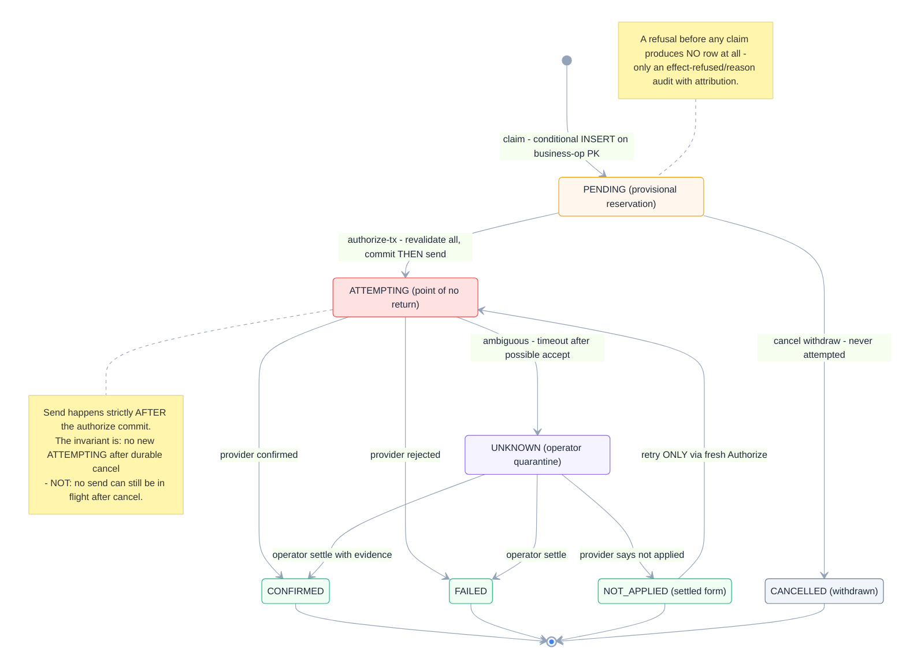

**Internalize:**

- **`CANCELLED` means the provider was never called.** It is a withdrawal of a still-pending reservation, reported separately from failures — the contract never conflates `in_flight` with `withdrawn`.
- **`UNKNOWN` is quarantine, not a retryable failure.** It exists because the outcome is genuinely ambiguous. Only an authorized operator settles it — atomically, with an evidence note, idempotent on (op, outcome, note). Blind retry is prohibited; `UNKNOWN → ATTEMPTING` direct is prohibited.
- **`NOT_APPLIED` is the settled form of "the provider definitively did not do it."** It is retryable only through a fresh, full authorization — never a shortcut.
- **No exactly-once provider delivery is claimed.** The contract guarantees no duplicate *confirmed* business effects, no silently lost operations, no blind retries of unknown outcomes — provider-side idempotency stays your job.

Source: contract §7/M3, §4.2 effect/cancel ordering, §16.1 (atomic settlement, `RECONCILING` removed).

---

## 4. The cancel race (X-05) — who wins, and what each outcome reports

The nastiest bug class the review found was check-then-act across transaction boundaries: a liveness check in one transaction, a claim in another, and a cancel landing in the gap. The contract closes it by making cancel and the `PENDING → ATTEMPTING` transition serialize **at the claim boundary**. This sequence diagram is the mental model to keep: both interleavings are legal, and each has a defined, honest outcome.

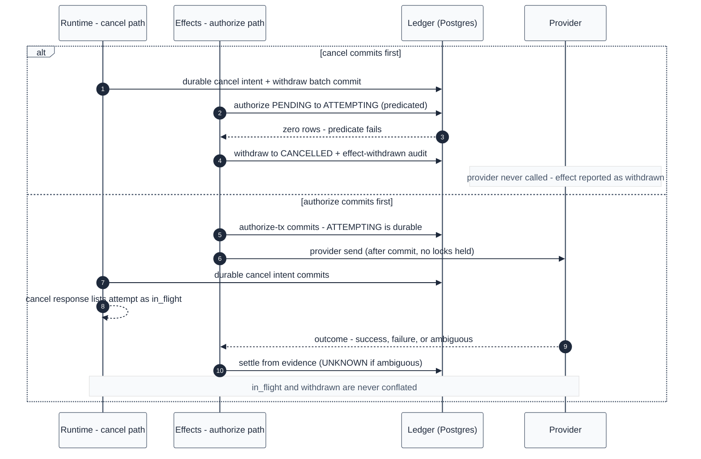

**Internalize:**

- **Durable intent precedes every stop.** Cancel writes its intent in the same transaction that settles approvals and withdraws `PENDING` effects; the executor stop is requested only after commit. A crash mid-cancel leaves intent standing, and redelivery converges.
- **"Point of no return" is a transaction commit, not a hope.** Once the authorize transaction commits, the send happens and cancellation cannot recall it — the contract reports it in-flight and settles from evidence instead of pretending to stop it.
- **The enforceable invariant is precise:** *no new `ATTEMPTING` transition after durable cancel* — never *no send can still be in flight after cancel*. Do not build anything that assumes the stronger (false) claim.
- **Stale workers cannot win.** Every send is authorized by an owner/lease check inside the transition; a worker that lost its lease cannot send or overwrite a newer owner.

Source: contract §4/CR-03, §4.2, §7/M3, §7/M6; writeup §3.4.

---

## 5. The submission choke point — one door, so no retry can skip the gate

X-01 happened because "is this gated?" and "submit the workflow" lived in different functions, and a retry after a partial failure entered submit without re-passing the gate. The fix is structural: exactly one function, `submitChecked`, is the sole path to `Async.Submit` — proven by an audit of call sites and a grep test that fails CI on any new caller. The two-permission rule lives here: a **pending** approval authorizes entering the wait, nothing more.

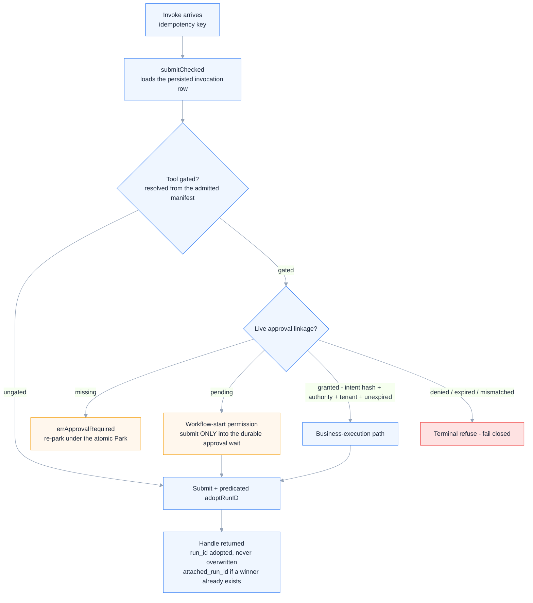

**Internalize:**

- **Gating comes from the admitted manifest, never from caller flags.** If you declare a tool ungated when it should be gated, the choke point will correctly submit it — the manifest is your responsibility.
- **A pending approval is never a business-execution authorization.** It permits exactly one thing: submitting the workflow to enter its durable approval-wait path. Consequential effects need a persisted *granted* decision, revalidated again at the effect boundary.
- **It fails closed twice.** At the service boundary (missing/denied/expired/mismatched linkage → refuse) *and* inside the executor (`Start`/`translate` rejects a gated tool whose request carries no approval ID) — so no future caller can bypass the check.
- **Run IDs are adopted, never overwritten** — the loser of a concurrent submit attaches instead of orphaning a live workflow (the X-03 fix).

Source: contract §5, §2 Rule 3 (two-permission table); writeup §3.5.

---

## 6. Retry as re-entry — dispatch on observed state, never on a flag

There is no `isRetry` flag anywhere in the framework, and your miniapp code should have none either. A retry is just another entry into the same state machine: load the persisted row, look at what it actually is, and dispatch accordingly. This is what makes X-02 impossible in practice — even a "parked but never submitted" record has a defined convergence handler.

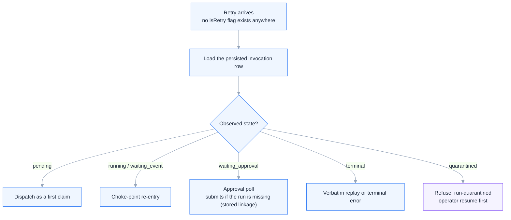

**Internalize:**

- **Every nonterminal state has a defined convergence path.** The framework's required-handler table covers seven paths (invoke, approval, submit-if-missing recovery, signal redelivery, effect claim/settle, cancellation redelivery, run attachment). If you add a workflow stage, you own the same discipline for it.
- **Idempotency is identity, not a flag.** The idempotency key claims the row once; every later call with the same key re-enters and observes. Design your business handlers to converge on redelivery too — duplicate signals and repeated cancels are normal.
- **Re-entry re-reads truth.** Nothing dispatches on what the caller *believes* the state is — only on what the row says. A stale belief produces a defined conflict error, which is a feature: reload and reconcile.

Source: contract §6; writeup §3.3.

---

## 7. The approval bridge and the sweeper — what recovers automatically

The approval table is the durable source of truth; the DBOS signal is only a hint. Decisions are audited at commit (before any signal), so a crash between commit and signal loses nothing — the lifecycle sweeper redelivers. The sweeper runs at startup, on a tick (default 30s), and opportunistically on `Status`/poll paths, and it owns three convergences: lost signals (S1), expiry observation (S2), and settlement discovery (S3). This is why your miniapp must **not** depend on polling for correctness — and must not depend on its own timers for expiry either.

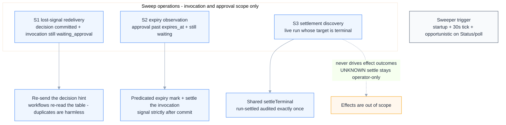

**Internalize:**

- **The bound is conditional, and the conditions are explicit.** Convergence within one sweep interval holds *while* at least one healthy sweeper runs with PostgreSQL and the relevant DBOS family available, and the batch processor keeps up with backlog. Outages delay convergence — visibly, with counts, never silently. A stopped sweeper regresses to pre-sweeper behavior; alert on its health.
- **Safety does not depend on convergence.** The durable gates hold regardless: a settled invocation authorizes no new effect. The sweeper is about *liveness* (decisions get observed, expiries get marked, completions get recorded), not about safety.
- **The sweeper never settles effects.** No automatic reconciliation exists in Phase 1; `UNKNOWN` settlement stays an operator action with evidence. Do not wait for the sweeper to fix a quarantined effect.
- **Expiry needs a supplied deadline.** Expiry is observed, never invented — always set `expires_at` on approvals whose latency you care about, and let S2 do the waking (a long `Recv` is woken by the S2 signal, not by its own timeout).

Source: contract §8–§8.3, §7/M2; writeup §3.8, §3.11.

---

## 8. Inside the authorize transaction — the lock order and full revalidation

The `PENDING → ATTEMPTING` transition is one transaction that takes locks in a single global order — invocation → approval → sequence → policy-control → effect — and revalidates *everything* inside it. The send happens only after commit, so no lock ever crosses the external call. This diagram is also the template for your own multi-row transactions: same order, same no-hold-across-external-calls rule.

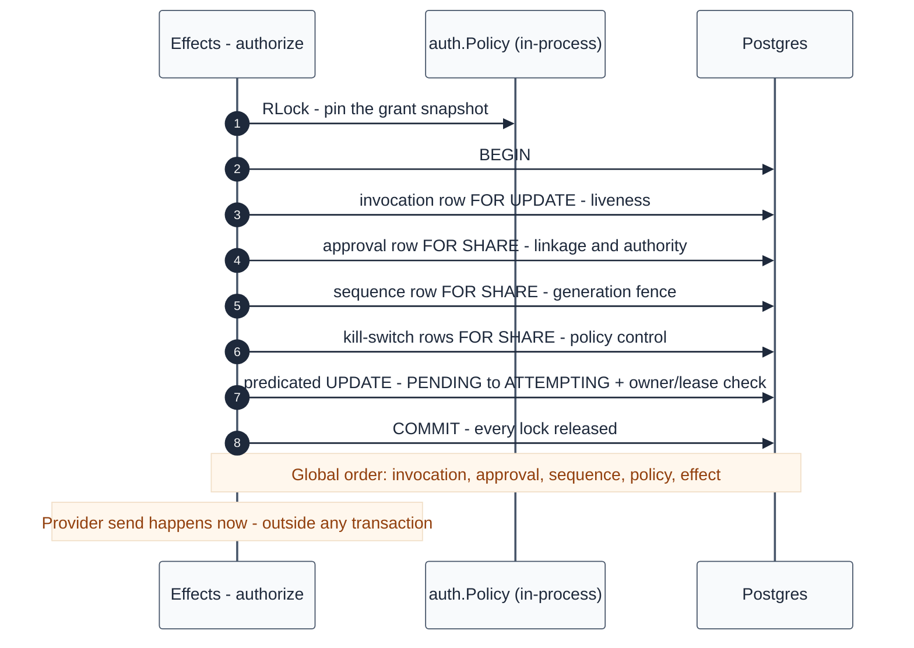

**Internalize:**

- **The order is deadlock-freedom, not bureaucracy.** Every multi-row transaction takes locks in this same order; the no-cycle proof depends on it, and concurrency tests (with `statement_timeout`) enforce it. Never hold a PostgreSQL lock across a provider send, a DBOS submission, a long wait, or a signal wait.
- **Advisory entity locks are outermost-first** — acquired before any transactional row lock, never while holding one. (The contract's earlier "leaf" wording was reversed by an amendment; §16 records the correction.)
- **Grants join the transaction as a pinned snapshot**, not a row: the in-process `RLock` pins the grant set for the read. In-process revocation races are closed; cross-replica coherence remains a deployment property (rolling restart) — a named residual.
- **Full revalidation means all of it, every time:** liveness, approval linkage and authority, grants, token, kill switches, eligibility and generation ownership, expected effect state/owner/lease. A retry authorization is a *new* authorization, never a lock inheritance.

Source: contract §4, §4.1, §4.2, §7/M3 authorize row; writeup §3.4.

---

## 9. The five identities — the single most common source of Class D bugs

Conflating identity scopes produces defects that only manifest under concurrency or retry — never in the happy path. Each scope has its own key and its own failure mode; pick the right key for each operation and the framework's predication does the rest. ("Delete this lead" is an entity operation; "send this specific touch" is a sequence-and-effect operation.)

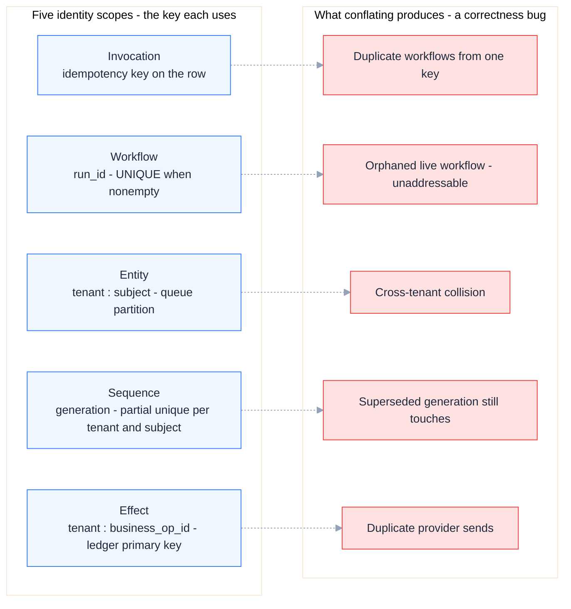

**Internalize:**

- **The effect identity must be stable across retries.** A UUID minted per attempt defeats the whole ledger — predication cannot dedup what you did not key consistently. This is your choice and your responsibility.
- **Run IDs are adopted, never overwritten** — and the attached loser stores the winner in `attached_run_id` (its own `run_id` stays empty; `UNIQUE (run_id) WHERE run_id <> ''` backs this in migration 000006).
- **Composite keys are canonically escaped** (`%`→`%25`, `:`→`%3A` per part, joined with `:`) by one shared helper — never build `tenant:subject` keys by string concatenation yourself.
- **The sequence generation is a fence, not just a label** — an attempt by a superseded generation is refused *at the authorization boundary* (`effect-refused/superseded`), because cooperative cancellation cannot stop an in-flight step.

Source: contract §6, §7/M4, §7/M5, §10/X-19, §10/X-22; writeup §2.2.

---

## 10. Attach and DETACH-ONLY cancel — who follows whom

When two invocations race on the same entity's sequence, exactly one workflow is submitted: the winner owns it, the loser attaches and follows. Cancel semantics differ by role — and the owner-approved DETACH-ONLY decision exists so an observer can never destroy a shared workflow that others depend on. Six acceptance checks and seven named tests pin this behavior.

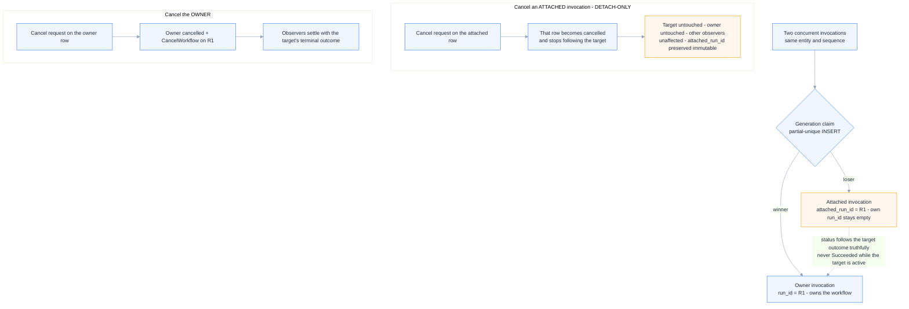

**Internalize:**

- **An attached invocation can never implicitly cancel the shared workflow.** Detach-only is the contract: the row settles `cancelled`, keeps `attached_run_id` for audit, and the target (and everyone else watching it) is untouched.
- **Cancelling the owner is the opposite:** the owner owns the workflow, so its cancel requests `CancelWorkflow` on the target, and all attached observers settle with the target's outcome — success, failure, or cancel, propagated truthfully.
- **Attachment re-resolves.** If the target finished and a newer live generation exists, an attached record re-attaches; with no live generation, it reports the target's outcome.
- **If your business model has fan-out observers, design their cancel UX around DETACH-ONLY** — "cancel my view of this work" and "cancel this work" are different operations with different authority.

Source: contract §7/M5, §7/M6 (DETACH-ONLY, owner decision recorded verbatim), §10/X-08; writeup §3.7.

---

## 11. Who owns what — the boundary that prevents the first incident

The framework removes three categories of complexity. It does not remove the five categories the developer still owns — and the first incident for an over-trusting team is always in a category the framework never claimed to handle. This diagram is the boundary check to run against any design before you build.

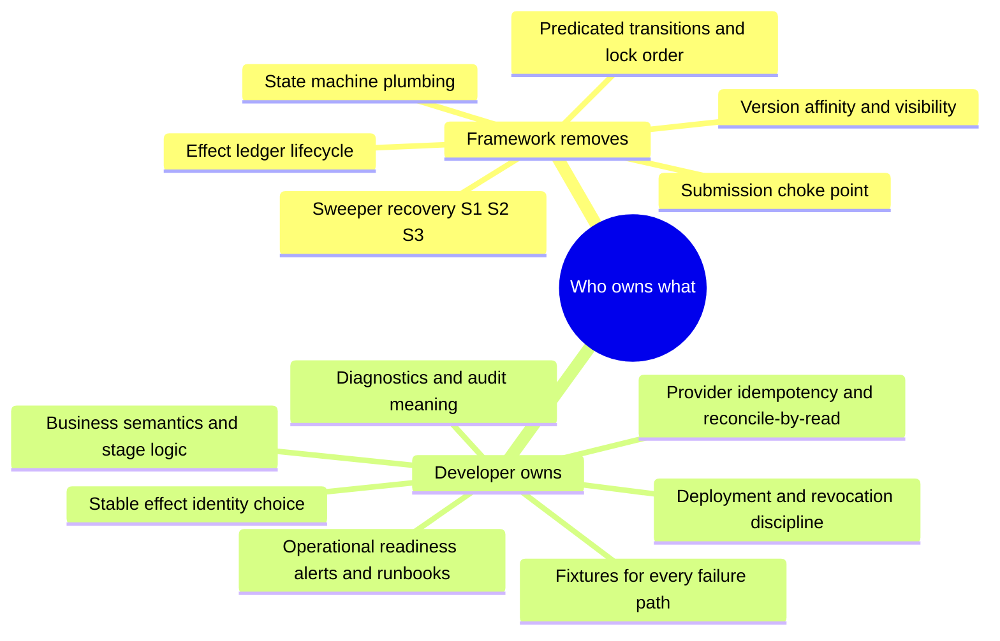

**Internalize:**

- **The framework's guarantees are about lifecycle correctness, not business correctness.** It cannot know that a lead is ineligible after unsubscribing, or that escalation needs a human after three failed touches — your predicates, checked at every stage, are yours.
- **Provider semantics stay yours.** Use provider idempotency keys where offered; specify a reconcile-by-read method where not. The framework enforces that ambiguity becomes `UNKNOWN` — it cannot tell you what the provider actually did.
- **Version strategy is a judgment call you make** (compatible patch vs. version bump), backed by framework mechanism: affinity keeps v2 workers off v1 workflows, foreign-version pending counts are visible, dead-lettered runs quarantine instead of silently failing.
- **"The framework handles it" is the trap sentence.** The right sentence is "the framework gives me the tools" — then enumerate your failure paths.

Source: writeup Part 4, §7.2; contract §14 (standing boundaries).

---

## 12. The testing discipline — fixtures that actually discriminate

The contract's Rule 6 is falsifiable evidence: every invariant claim ships with a test that would fail if the claim were false. The review found that all five HIGH bugs lived in paths the suite never covered — interleavings and failure branches. Your miniapp inherits the same discipline: fault injection at the *real* boundary, barrier-synced concurrency, real PostgreSQL and real process kills, and red/green runs with recorded digests.

```mermaid
---
config:
  theme: base
  themeVariables:
    primaryColor: "#EFF6FF"
    primaryBorderColor: "#3B82F6"
    primaryTextColor: "#1E293B"
    lineColor: "#94A3B8"
    fontSize: "14px"
---
flowchart LR
    A["Enumerate failure paths<br>crash at every stage boundary"] --> B["FaultInjector<br>fails a named op on its Nth attempt"]
    B --> C["Barrier-synced concurrency<br>separate connections - never sleeps"]
    C --> D["Real PostgreSQL + real process kill"]
    D --> E{"Red-green check"}
    E -->|"red: fails on the pre-fix snapshot"| F["green: passes on the fixed tree<br>same test source both sides"]
    F --> G["Digests + exact command<br>recorded in the evidence register"]

    style E fill:#FFF7ED,stroke:#F59E0B,color:#1E293B
    style F fill:#F0FDF4,stroke:#10B981,color:#1E293B
    style G fill:#F0FDF4,stroke:#10B981,color:#1E293B
```

**Internalize:**

- **A test that passes on both sides of a fix is not evidence.** If there is no pre-fix implementation to run against, discriminate on invariants instead — do not manufacture an artificial red run.
- **"Make the function return an error" is not fault injection.** The failure must land at the real boundary — the DBOS submit, the signal send, the commit of the decision, the provider call. The injector is nil in production by construction (a test asserts it).
- **Sequential "concurrency" tests exercise the wrong code path.** Race tests need a synchronization barrier and, where isolation matters, separate database connections. Deadlocks fail via `statement_timeout` — a hung test is a bug in the test.
- **Mocks that deduplicate their own log prove nothing** (the X-07 lesson): every operation must be measured, so "exactly one send" is assertable.

Source: contract §9, §13; writeup Part 5.

---

## The design checklist — from diagrams to a robust miniapp

Before shipping a Class D workflow, walk each diagram and answer its question against *your* design:

| From diagram | Ask yourself |
|---|---|
| 2 — M1 | Does every stage of my workflow have a defined state, including the failure branches? What converges each one? |
| 3 — M3 | Is every external effect a ledger entry with a **stable** identity? What does each outcome — including `UNKNOWN` — mean for my business? |
| 4 — Cancel race | If cancel lands mid-stage, what does my workflow report — `in_flight` or `withdrawn` — and is that honest? |
| 5 — Choke point | Is my manifest's gating declaration correct? Am I passing approval IDs around instead of linkage checks? |
| 6 — Re-entry | Will my handlers converge if invoked twice, three times, after a crash? Is any of my logic branching on a "retry" notion? |
| 7 — Sweeper | Am I depending on polling or my own timers for anything the sweeper should own? Are my approvals' `expires_at` values set? |
| 8 — Lock order | If I add a multi-row transaction, does it take locks in the global order and hold none across external calls? |
| 9 — Identities | Which of the five scopes does each of my operations use? Did I concatenate any key by hand? |
| 10 — Attach | Does my UI distinguish "cancel my view" from "cancel this work"? |
| 11 — Ownership | Which of the five developer-owned categories have I actually staffed — fixtures, diagnostics, deployment, ops? |
| 12 — Testing | For each failure path: which named fault, at which boundary, asserts what convergence? |

A design that answers all eleven is not guaranteed incident-free — but every incident it does have will be in a state you named, with an audit trail that says what happened, and a recovery path that says what to do next. That is the bar the contract was written to make reachable.
